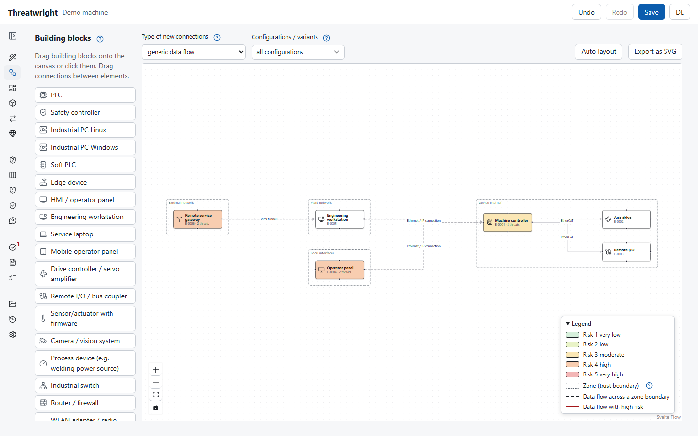
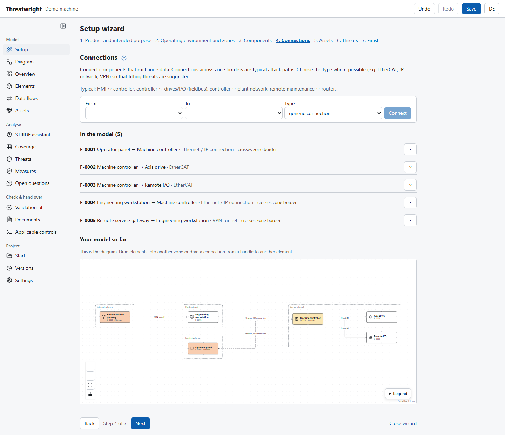
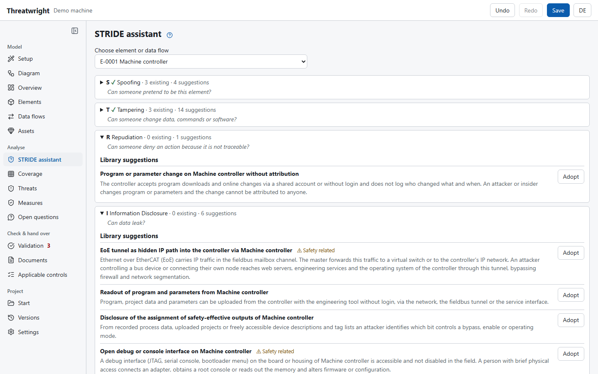
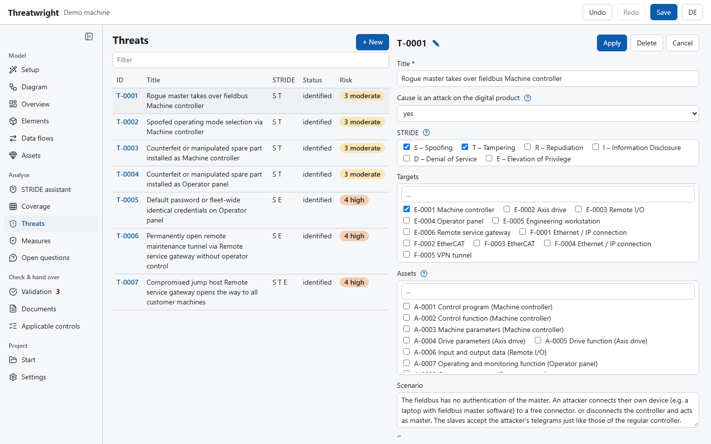
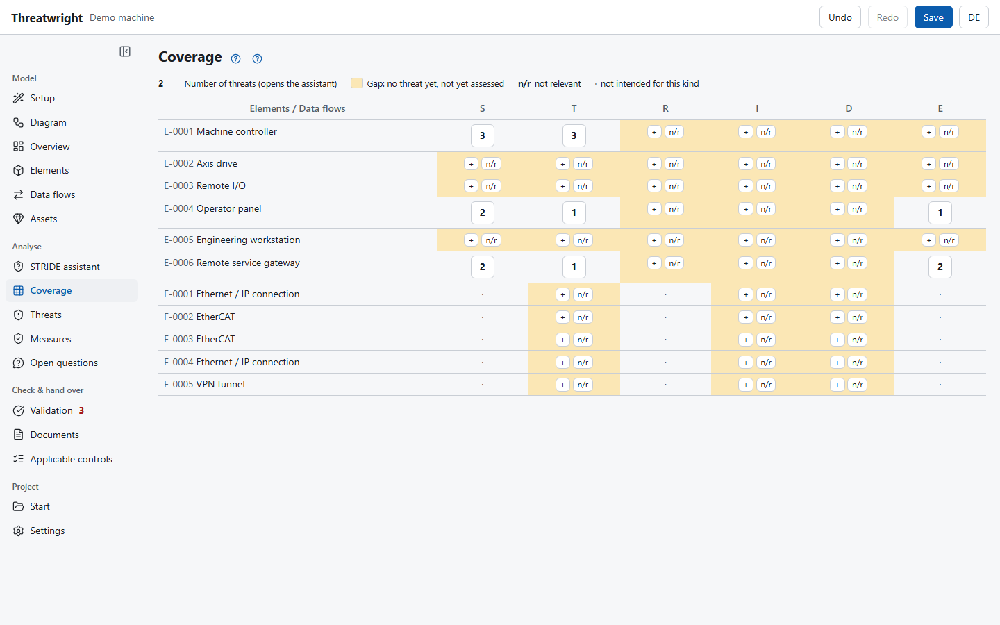

# Threatwright

[](https://github.com/cpyix/Threatwright/actions/workflows/ci.yml)
[](https://github.com/cpyix/Threatwright/actions/workflows/leakcheck.yml)
[](https://github.com/cpyix/Threatwright/actions/workflows/audit.yml)
[](https://github.com/cpyix/Threatwright/releases)
[](https://pypi.org/project/threatwright/)
[](pyproject.toml)
[](LICENSE)
[-informational)](SECURITY.md)
[](#ai-assisted-development)

Local-first threat modelling and risk analysis for products with digital elements under the EU Cyber Resilience Act (CRA), following **BSI TR-03183-1**. Built for machine and plant manufacturers (OT) whose engineers are not security specialists. Status: **alpha** (0.1.0).

- **Offline and local:** Windows and Linux, no admin rights, no network access at runtime, no telemetry.
- **Git is the database:** one YAML file per object, stable IDs, saving without changes produces no diff. Merge requests are the change history; `threatwright diff` creates change evidence between releases.
- **TR-03183-1 as configuration:** scales, factors, risk matrix and acceptance rules live in a method file with page references and can be overridden per project ([Methodik](docs/methodik.md)).
- **Building blocks instead of empty forms:** OT library with 80 element types, 239 threat and 111 measure templates; STRIDE assistant, coverage matrix, data flow diagram.
- **Documents from your own templates:** DOCX, ODT, Markdown, HTML, PDF via LibreOffice; layout and outline without code changes ([Vorlagenreferenz](docs/vorlagenreferenz.md)).
- **CI:** the same checks as the GUI in GitLab or GitHub pipelines, template pre-filled per project ([CI](docs/ci.md)).
- **Interop:** OSCAL import (catalogs such as Grundschutz++, profiles, component definitions), Threat Dragon and CSV import, CSV/JSON/XLSX export.



<details>
<summary><strong>More screenshots</strong>: setup wizard, STRIDE assistant, threat assessment, coverage</summary>

**Setup wizard:** connections step with the live diagram


**STRIDE assistant:** library suggestions per category, each with the question behind it


**Threats:** list with risk and the assessment form


**Coverage:** every element and data flow against every STRIDE category


</details>

The screenshots show a neutral demo model built from the library building blocks; `uv run python scripts/screenshots.py` regenerates them.

**Contents:** [Install](#install) · [Usage](#usage) · [Docker](#docker-cli-and-pipelines) · [Hosting the GUI](#hosting-the-gui-container-or-server) · [AI assistants](#editing-models-with-an-ai-assistant) · [Documentation](#documentation-german) · [Develop and contribute](#develop-and-contribute) · [License](#license)

## Use Threatwright

### Install

**Portable download (no Python, no admin rights).** From the [releases](https://github.com/cpyix/threatwright/releases) download `threatwright-<version>-windows-amd64.zip` or `threatwright-<version>-linux-x86_64.tar.gz`, unpack it anywhere (e.g. your user folder or a USB stick) and run `threatwright.exe` (Windows) or `./threatwright` (Linux). Without arguments the GUI opens in your default browser. Verify downloads with `SHA256SUMS` (see [SECURITY.md](SECURITY.md)).

**With Python (3.12+):**

```
pipx install threatwright
threatwright
```

Optional: Git (change evidence between releases), LibreOffice (PDF output). To build from source, see [Develop and contribute](#develop-and-contribute).

### Usage

```
threatwright init my-product --name "My product"   # new project (TR-03183-1 standard)
threatwright --project my-product                  # GUI in the default browser
threatwright --project my-product --no-browser     # GUI, prints the URL instead
threatwright validate my-product                   # all rules; exit code 1 on errors
threatwright build my-product --format docx        # documents into my-product/build
threatwright diff v1.0 --path my-product           # change evidence since tag v1.0
threatwright ci gitlab my-product                  # GitLab pipeline for this project
threatwright --help                                # all commands
```

Started inside a project folder, `threatwright` opens that project directly. By default the GUI runs on `127.0.0.1` only, on a random port, is not reachable from other machines and needs no login; a strict Content Security Policy applies and nothing leaves your machine. The GUI follows your browser language (German or English). Projects created with an older release open in newer ones; their files are brought up to date on the next save ([details](#compatibility-and-releases)).

### Docker (CLI and pipelines)

The image `ghcr.io/cpyix/threatwright:<version>` contains the CLI, the GUI, Git and LibreOffice (for PDF). The pipeline templates use it. Run it on a project in the current folder:

```
# Linux / macOS
docker run --rm -v "$PWD:/work" --user "$(id -u):$(id -g)" ghcr.io/cpyix/threatwright:<version> validate .
docker run --rm -v "$PWD:/work" --user "$(id -u):$(id -g)" ghcr.io/cpyix/threatwright:<version> build . --format pdf

# Windows PowerShell
docker run --rm -v "${PWD}:/work" ghcr.io/cpyix/threatwright:<version> validate .
```

`--user` makes generated files belong to you instead of the container user.

### Hosting the GUI (container or server)

Secure by default ([ADR-0013](docs/adr/0013-self-hosted-gui.md)): as soon as the GUI is reachable for others, it asks for a login. The local GUI on `127.0.0.1` has no login and is not reachable from other machines.

| Option | Meaning |
|---|---|
| `--host 0.0.0.0` | Listen on all interfaces (needed inside a container). Default `127.0.0.1`. |
| `--port 8080` | Fixed port. Default: random free port. |
| `--allowed-host NAME` | Host name the browser uses (`localhost`, `threatwright.example.com`, …); accepted on any port. Repeatable. All other Host headers are rejected. |
| `--workspace DIR` | Folder with the projects users may open, create and upload. Default: the working directory (`/work` in the image). |
| `--auth basic` / `--auth none` | Login with HTTP Basic Auth, or none. Default: `basic` as soon as `--host` is not loopback or an `--allowed-host` is set (server mode); `none` for the local GUI. |
| `--users-file FILE` | Users for Basic Auth, one `name:hash` line each (create lines with `threatwright hash-password <name>`). |
| `THREATWRIGHT_USER`, `THREATWRIGHT_PASSWORD` (env) | One user without a users file. User defaults to `admin`. |

#### Login

In server mode the GUI always asks for a user name and password (HTTP Basic Auth), in this order of sources:

1. `--users-file`: several users, passwords stored as PBKDF2 hashes. Create a line with `docker run --rm -it ghcr.io/cpyix/threatwright:<version> hash-password alice` and collect the lines in a file.
2. `THREATWRIGHT_PASSWORD` (and optionally `THREATWRIGHT_USER`): one user.
3. Neither set: Threatwright generates a password once and stores it in the workspace under `.threatwright/password` (readable by its owner only, ignored by Git, never written to the log). Read it with `docker exec <container> cat /work/.threatwright/password`. It is never open by accident.

Switch the login off only with `--auth none`, and only when something in front of Threatwright already authenticates every request (e.g. a reverse proxy with SSO). Threatwright then prints a warning at start.

Basic Auth sends the password with every request. Beyond your own machine, always put TLS in front (see the Compose example).

#### Persistent storage

Projects, generated documents and the version history (`.threatwright-history`) live in the workspace `/work` inside the container. **Without a volume they are gone when the container is deleted.** Always mount the workspace:

- a host folder: `-v "$PWD/projects:/work"` (easy to back up and to use with Git), or
- a named volume: `-v threatwright-data:/work` (survives `docker rm` and image updates).

Back up that folder or volume like any other data, and commit the projects to Git.

#### On your own machine with Docker

```
# Linux / macOS
docker run --rm -p 127.0.0.1:8080:8080 -v "$PWD/projects:/work" --user "$(id -u):$(id -g)" \
  -e THREATWRIGHT_PASSWORD='choose-a-long-password' \
  ghcr.io/cpyix/threatwright:<version> --no-browser \
  --host 0.0.0.0 --port 8080 --allowed-host localhost

# Windows PowerShell
docker run --rm -p 127.0.0.1:8080:8080 -v "${PWD}/projects:/work" `
  -e THREATWRIGHT_PASSWORD='choose-a-long-password' `
  ghcr.io/cpyix/threatwright:<version> --no-browser `
  --host 0.0.0.0 --port 8080 --allowed-host localhost
```

Open `http://localhost:8080/` and log in as `admin`. `-p 127.0.0.1:8080:8080` keeps the port on your machine only. The start page lists the projects in `projects/`; you can open one, create a new one, upload a project from your computer as `.zip` and download the open project as `.zip`.

#### On a server: Docker Compose with TLS

Threatwright asks for the login; the proxy ([Caddy](https://caddyserver.com/)) adds HTTPS with an automatic certificate. Threatwright itself is not published on any port.

```yaml
# compose.yaml
services:
  threatwright:
    image: ghcr.io/cpyix/threatwright:<version>
    command: [--no-browser, --host, 0.0.0.0, --port, "8080",
              --allowed-host, threatwright.example.com, --users-file, /etc/threatwright/users]
    volumes:
      - ./projects:/work                          # persistent: projects and version history
      - ./users:/etc/threatwright/users:ro        # lines from `threatwright hash-password <name>`
    restart: unless-stopped
  caddy:
    image: caddy:2
    command: caddy reverse-proxy --from threatwright.example.com --to threatwright:8080
    ports: ["443:443", "80:80"]
    volumes:
      - caddy-data:/data                          # persistent: certificates
    restart: unless-stopped
volumes:
  caddy-data:
```

Start with `docker compose up -d` and open `https://threatwright.example.com/`. The workspace must be writable by UID 10001 (`chown -R 10001 projects`), or set `user:` to the folder's owner. To add or remove users, edit `users` and run `docker compose restart threatwright`.

**With your company's login (SSO) instead:** put an authenticating proxy in front (e.g. oauth2-proxy, or a proxy with `basic_auth`), remove `--users-file` and add `--auth none`. Any proxy works: terminate TLS, authenticate, forward to port 8080 and pass the original `Host` header.

#### On a server without Docker

Run `threatwright --project my-product --no-browser --port 8080` (bound to `127.0.0.1`, so not reachable from the network) and reach it through an SSH tunnel: `ssh -L 8080:127.0.0.1:8080 server`, then open `http://127.0.0.1:8080/` locally.

#### Before you host it

- **Login and TLS.** Keep the login on (default), use long passwords, and serve it over HTTPS beyond your own machine.
- **One shared session per instance.** Everyone works on the same open project and in-memory state; it suits one person or a coordinated team. Run one instance per team if several people work in parallel.
- **Persistent storage.** Mount `/work` (see above), or the data is lost with the container.
- **Git stays with you.** The GUI saves files into the workspace; commit, push and merge requests happen outside, as with the local GUI.
- **Confined to the workspace.** The GUI only opens, creates, uploads and imports inside the workspace. Uploaded archives are checked (size limit, no paths outside the target folder, no symlinks). The native folder dialog and "open build folder" are switched off.
- **The local GUI** (no `--host`) is reachable from your own machine only and has no login; other users and programs on the same machine can reach it.

### Editing models with an AI assistant

Project files are plain YAML, so an AI assistant can create or change a model directly in the files. [`skills/threatwright-model/SKILL.md`](skills/threatwright-model/SKILL.md) tells it how: project layout, every file format with examples, the risk method values, the workflow from scope to measures, and the rules it must keep (stable ids, no invented facts, rule 3.3 decided per threat, `threatwright validate` after every change).

- **Claude:** copy the folder `skills/threatwright-model` into your skills directory (e.g. `~/.claude/skills/`); the skill loads when you ask to build or edit a Threatwright model.
- **Other assistants:** give them `SKILL.md` as instructions or context.

Review what the assistant changed (e.g. with `git diff` or `threatwright diff`) before you rely on it.

### Documentation (German)

[Schnellstart](docs/schnellstart.md) · [Tutorial](docs/tutorial.md) · [Methodik](docs/methodik.md) · [Prüfregeln](docs/pruefregeln.md) · [Ist das ein Cyberrisiko?](docs/faq-cyberrisiko.md) · [Bibliotheksformat](docs/bibliotheksformat.md) · [Vorlagenreferenz](docs/vorlagenreferenz.md) · [Git-Arbeitsweise](docs/git-arbeitsweise.md) · [OSCAL](docs/oscal.md) · [CI](docs/ci.md) · [Offene Prüfpunkte](docs/VERIFY.md) · [CRA-Selbstbewertung](docs/cra-self-assessment.md)

## Develop and contribute

### Build from source

Requirements: Python 3.12+, [uv](https://docs.astral.sh/uv/), Node.js 24 (only to build the GUI bundle).

```
git clone https://github.com/cpyix/threatwright.git
cd threatwright
uv sync
cd app && npm ci && npm run build && cd ..    # builds the GUI into src/threatwright/web
uv run threatwright                           # start the GUI
```

Portable bundle: `uv run python packaging/build.py` (output in `dist/`). Docker image: `docker build -t threatwright:local .` from the repository root (the frontend is built inside the image, no local Node.js needed).

### Checks

```
uv run pytest                                # incl. GUI end-to-end and accessibility tests (German and English)
uv run ruff check . && uv run mypy           # lint and strict typing
cd app && npm run check                      # frontend type check
```

### Repository layout

```
src/threatwright/      Python core: model, method, rules, library, assistant, render, oscal, vcs, interop, cli, server
  branding.py          product name (single place; app/src/branding.ts for the UI)
  methods/             risk methods as configuration (tr-03183-1)
  libraries/ot/        element, threat, measure templates (CC BY 4.0)
  catalogs/            verified reference IDs (ATT&CK for ICS, EMB3D, IEC 62443 FR, CRA)
  templates/           neutral document templates
  ci_templates/        GitLab/GitHub pipeline templates
  oscal/schemas/       bundled NIST OSCAL schemas
app/                   Svelte 5 + Svelte Flow frontend (bundled into the package)
schemas/               JSON Schemas v1 for all file types
tests/                 unit, roundtrip, rendering, e2e (Playwright, axe)
docs/                  user docs (de), ADRs (en), VERIFY.md
ci/                    static pipeline templates
packaging/             PyInstaller build (portable, no admin rights)
scripts/               repo maintenance (leak checks, library coverage)
```

Architecture decisions (English): [`docs/adr/`](docs/adr/). Planned work: [ROADMAP.md](ROADMAP.md).

### Compatibility and releases

Projects from any earlier release open in later releases ([ADR-0015](docs/adr/0015-compatibility.md)): every file carries a `schema_version`, older files are upgraded on load and written on the next save (or with `threatwright migrate`), and files from a newer release are refused with a clear message. A change to the file format needs a migration step in `src/threatwright/model/migrations.py`.

Release checklist:

1. Version in `pyproject.toml`, `src/threatwright/__init__.py`, `app/package.json` (and `uv lock`, `npm install`).
2. `uv run python scripts/compat_snapshot.py`: adds `tests/fixtures/compat/v<version>/`; commit it. CI then checks that every later release still opens it.
3. Optionally `uv run python scripts/screenshots.py` for the README images.
4. Merge, then tag `v<version>` on `main`; the release workflow builds and publishes everything.

### Contributing

```
pip install pre-commit && pre-commit install
```

Hooks run gitleaks and a forbidden-files check; CI repeats both over the full history. Changes go through pull requests. Security issues: see [SECURITY.md](SECURITY.md).

### AI-assisted development

Large parts of the code, tests and documentation in this repository were written with AI coding assistants ("vibe coding"), directed and reviewed by the maintainer. This is deliberate, and contributions made with AI assistance are explicitly welcome, under the same rules as any other contribution.

What keeps the quality up is not who or what wrote a line, but the gates every change has to pass before it reaches `main` or a release:

- **Pull requests only:** `main` is protected; a change needs the required checks `ci-ok` and `leakcheck` to pass.
- **Tests and static checks:** unit and end-to-end tests (Playwright, in German and English, including an axe-core accessibility check in light and dark mode) on Ubuntu and Windows with Python 3.12 and 3.14; `ruff`, strict `mypy` and `svelte-check`.
- **Security scans:** CodeQL code scanning on every pull request; gitleaks and a forbidden-files check over the full Git history; `pip-audit`, `npm audit` and OSV for dependencies, on every pull request and weekly.
- **Supply chain:** GitHub Actions pinned to commit SHAs, locked dependencies, releases with build provenance, Sigstore-signed checksums and CycloneDX SBOMs, PyPI via Trusted Publishing.

These gates reduce risk; they do not prove the absence of errors. Threatwright supports a threat and risk analysis, it does not replace the judgement of the people responsible for it. Review the results before you rely on them, and report problems or security issues (see [SECURITY.md](SECURITY.md)).

## License

Code: AGPL-3.0 (see `LICENSE`). Bundled libraries and templates: CC BY 4.0. Your models and generated documents are yours.
